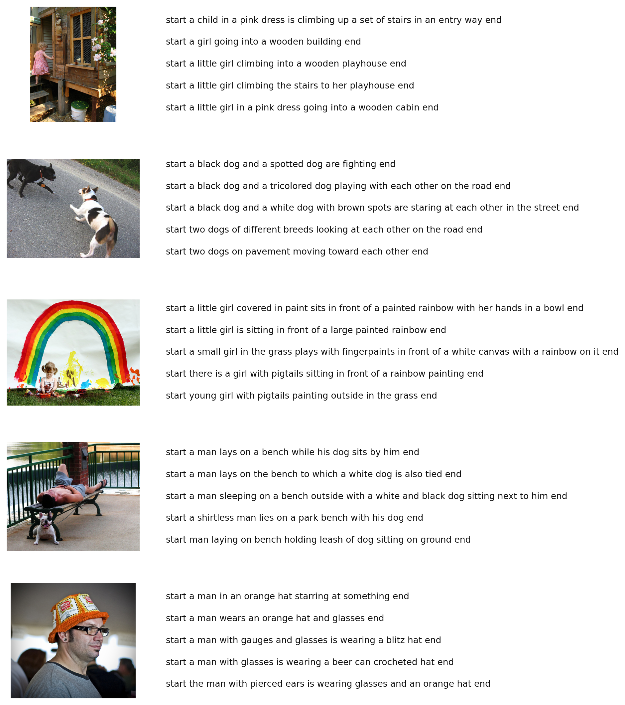
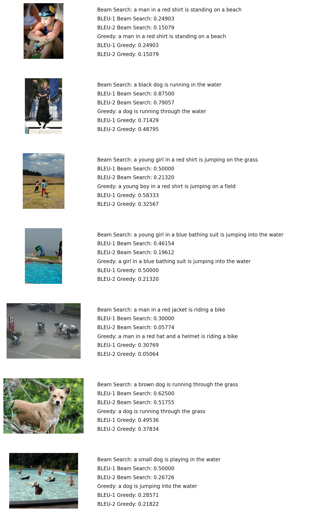
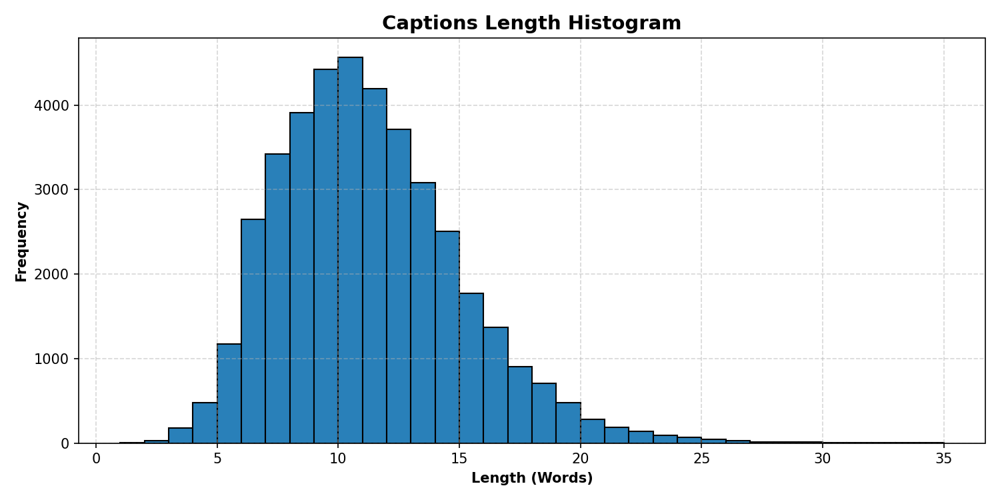

# Image-Caption-Generator
An end-to-end Deep Learning project developed to automatically generate natural language descriptions for images using a CNN-LSTM Encoder-Decoder architecture on the Flickr8k dataset.

## Technical Objective

Bridge Computer Vision and Natural Language Processing by extracting dense visual features from images and decoding them into grammatically coherent, context-aware descriptive captions while mitigating vocabulary repetition and hallucination.

## Model Deliverables & Reports

### 1. Dataset Exploration

Displays sample images from the dataset paired with all five ground-truth human reference captions to inspect descriptive diversity.

### 2. Model Prediction & BLEU Evaluation Report

Evaluates model inference on unseen test images across both Greedy Search and Beam Search decoding strategies, benchmarked against reference ground-truth captions using BLEU-1 and BLEU-2 metrics.

### 3. Caption Sequence Length Analysis

Analyses token distribution, minimum, maximum, and average sentence lengths across the corpus to determine optimal sequence padding parameters.

## Key Performance Indicators & Architecture Metrics

* Total Training Captions: 40,455
* Total Dataset Images: 8,091
* Vocabulary Size: 8,781 tokens
* Maximum Sequence Length: 37 tokens
* Feature Vector Dimension: 2,048 (InceptionV3 penultimate layer)
* Embedding & LSTM Hidden Units: 256 dimensions
* Evaluation Metrics: BLEU-1, BLEU-2 (with smoothing)
* Decoding Algorithms: Greedy Search & Beam Search (K = 4)
* Optimization: Adam Optimizer with Categorical Crossentropy & Learning Rate Decay

## Dataset

This project utilizes the benchmark Flickr8k dataset.

* 8,091 total photographs depicting real-world scenarios, people, animals, and outdoor actions
* 5 distinct, human-annotated ground-truth captions per image
* Bounded by `<start>` and `<end>` sequence tokens
* Split into Train, Validation, and Test sets

## Project Workflow

1. Loaded and parsed the raw `captions.txt` file across all 8,091 images
2. Cleaned text data (lowercasing, punctuation removal, number filtering, whitespace normalization)
3. Tokenized the cleaned text and built word-to-index mappings (`tokenizer.pkl`)
4. Extracted 2,048-dimensional visual feature vectors using pre-trained InceptionV3 and cached them to disk (`features.pkl`)
5. Designed a multimodal merge architecture combining image embeddings with an LSTM sequential decoder
6. Implemented a memory-efficient batch data generator with target-shape alignment
7. Trained and fine-tuned model weights with gradient clipping and learning rate plateaus (`caption_model.keras`)
8. Implemented inference algorithms with N-gram repetition blocking, temperature scaling, and trailing stop-word trimming
9. Evaluated predictions against reference captions using bilingual evaluation understudy (BLEU) scoring

## Tools and Skills

* Python 3.10
* TensorFlow & Keras
* Convolutional Neural Networks (CNN) & InceptionV3
* Recurrent Neural Networks (RNN) & Long Short-Term Memory (LSTM)
* Natural Language Processing (NLP) & Tokenization
* Greedy Decoding & Beam Search Algorithms
* BLEU Evaluation & Metric Scoring
* Matplotlib & PIL (Data Visualization)
* Feature Caching & Memory Optimization

## Project Files

* `flickr8k_caption_generator.py`: Complete pipeline for data preprocessing, model loading, and generating clean visual evaluation reports.
* `predict_custom_image.py`: Standalone inference tool to test any custom image (`.jpg` / `.png`) with anti-repetition decoding.
* `fast_fix_train.py`: Rapid alignment and fine-tuning script utilizing cached numerical feature vectors.
* `tokenizer.pkl`: Serialized Keras tokenizer preserving word-index mappings.
* `dataset_exploration_clean.png`: Visual exploration report.
* `model_evaluation_report_clean.png`: Evaluation prediction matrix and BLEU scoring visual report.
* `caption_length_histogram.png`: Sentence length frequency distribution visual.

## Project Status

Completed — full data pipeline, fine-tuned CNN-LSTM network weights, Greedy and Beam Search decoders with anti-repetition guards, and visual evaluation reports are fully generated and documented.

## Author

**Joshna Sree**  
Aspiring Data Analyst / Data Scientist
